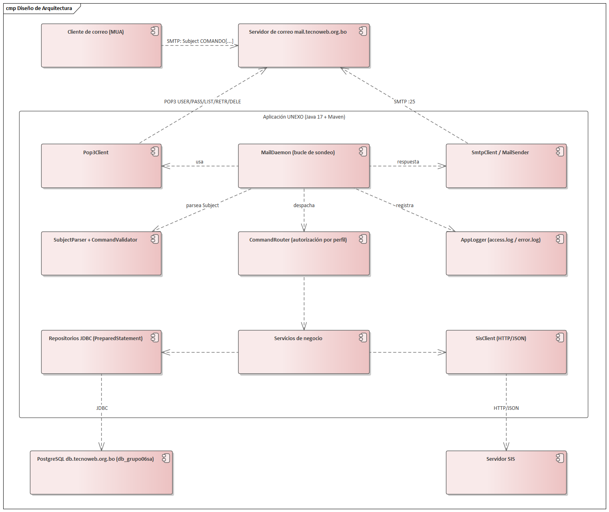
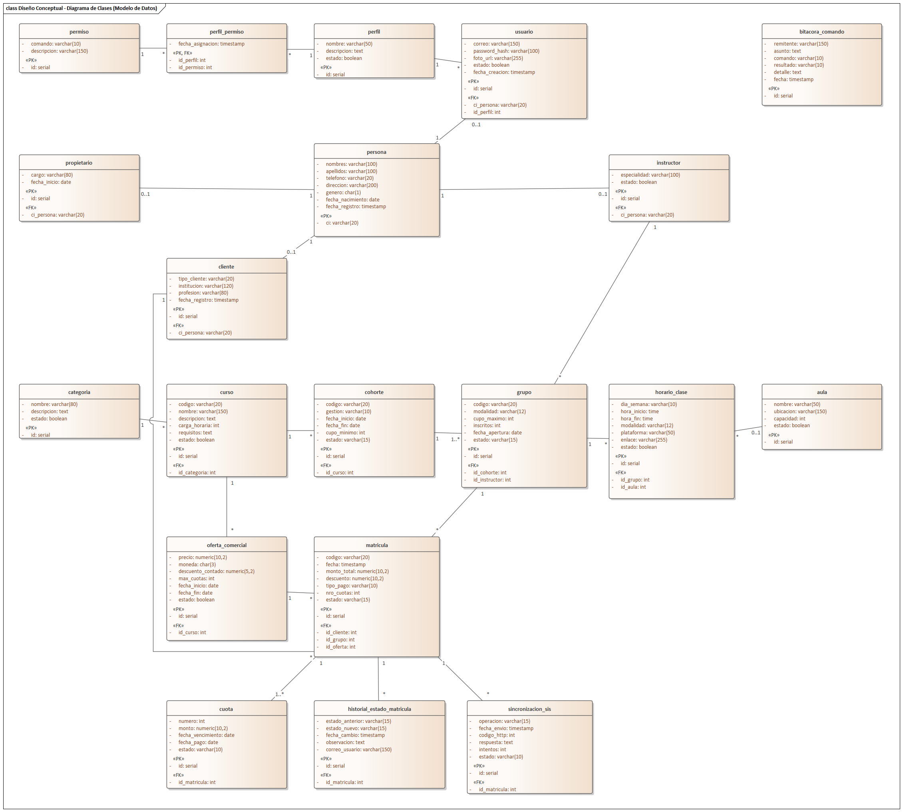
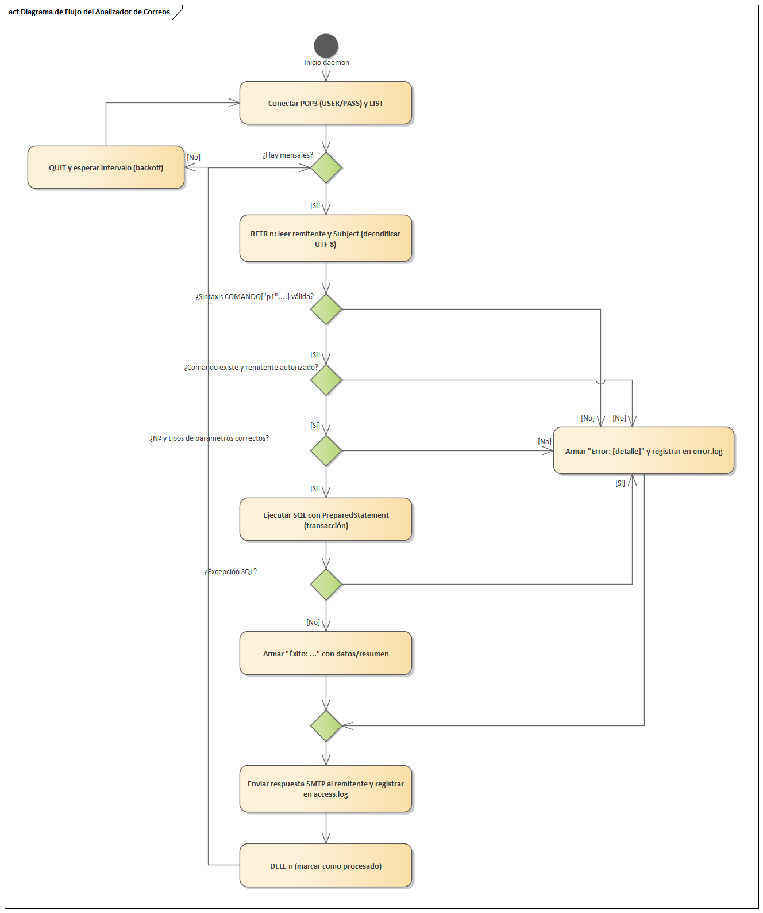
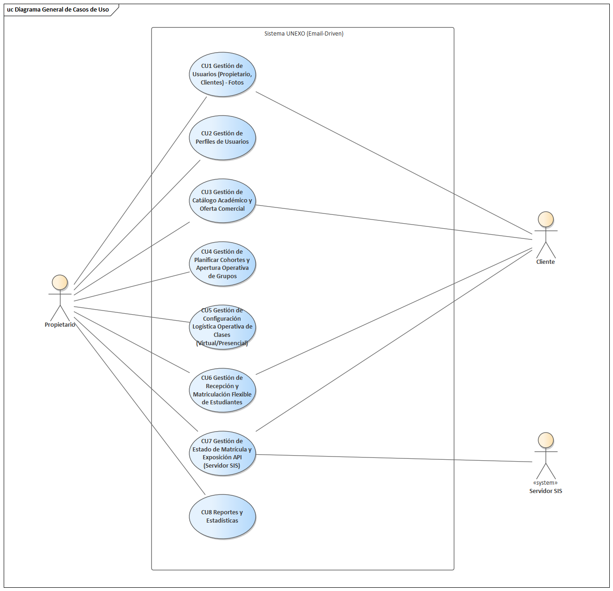

# UNEXO – Sistema Email-Driven (INF513 · Proyecto #1 · grupo06sa)

Backend que gestiona el catálogo académico, las cohortes y grupos, la logística de clases y la matriculación de estudiantes de **UNEXO**, una unidad que ofrece cursos. Los usuarios operan el sistema **solo por correo electrónico**: escriben un comando en el **asunto** de un mensaje dirigido a `grupo06sa@tecnoweb.org.bo` y reciben una respuesta automática con `Éxito: ...` o `Error: [detalle]`.

| | |
|---|---|
| Materia | INF513 – Tecnología Web · Gestión 2026-2 · UAGRM – FICCT |
| Grupo | 06sa — Cruz García Javier (222049261), Sejas Jiménez Alejandro Gerard (222009926), Otsubo Alurralde Carlos Diego (221086382) |
| Tecnologías | Java 17 · Maven · PostgreSQL (JDBC) · POP3/SMTP con sockets propios |

---

## 1. Arquitectura

```
[Cliente de correo] --SMTP--> [mail.tecnoweb.org.bo] <--POP3 (110)-- [MailDaemon]
                                       ^                                   |
                                       |                         SubjectParser + CommandValidator
                                       |                                   |
                                       |                    CommandRouter (permisos por perfil + AUTH)
                                       |                                   |
                                       |                  Servicios de negocio (CU1 … CU8)
                                       |                       |                     |
                                  SMTP (25) <-- SmtpClient   Db (PreparedStatement)   SisClient --HTTP/JSON--> [Servidor SIS]
                                                               |
                                                     [PostgreSQL db_grupo06sa]
```



| Paquete | Responsabilidad |
|---|---|
| `unexo.mail` | `MailDaemon` (bucle de sondeo con retroceso exponencial), `Pop3Client` (USER/PASS/LIST/RETR/DELE/QUIT), `MimeParser` (cabeceras, RFC 2047, adjuntos base64), `SmtpClient` (respuesta multipart texto + HTML en UTF-8). |
| `unexo.parser` | `SubjectParser` (analizador léxico del asunto), `CommandCatalog` (60 comandos tipados), `CommandValidator` (cantidad y tipo de parámetros). |
| `unexo.router` | `CommandRouter`: autorización por perfil (`perfil_permiso`), sesión `AUTH` de 30 min, despacho y traducción de errores SQL a mensajes legibles. |
| `unexo.service` | Lógica de negocio por caso de uso: `UsuarioService`, `PerfilService`, `CatalogoService`, `CohorteGrupoService`, `LogisticaService`, `MatriculaService`, `EstadoMatriculaService`, `SisClient`, `ReporteService`. |
| `unexo.repository` | `Db`: conexión JDBC, consultas **siempre con `PreparedStatement`** y transacciones. |
| `unexo.util` | `AppLogger` (`logs/access.log`, `logs/error.log`), `Respuesta`, `Html` (tablas y gráficos de barras), `Passwords` (PBKDF2). |

### Seguridad

- **Inyección SQL:** ningún valor del usuario se concatena al SQL; todos viajan como parámetros de `PreparedStatement`.
- **Validación en el servidor:** antes de llegar a la base de datos se valida el número exacto de parámetros y su tipo (entero, decimal, fecha `AAAA-MM-DD`, hora `HH:MM`, correo, enumerados).
- **Autorización:** cada comando es un permiso; el perfil del remitente debe tenerlo (`perfil_permiso`). Un cliente solo puede ver o modificar sus propios datos y matrículas.
- **Autenticación:** el perfil PROPIETARIO debe enviar `AUTH["contraseña"]` (válido 30 min). Las contraseñas se guardan con PBKDF2-HMAC-SHA256 y **nunca** se escriben en los logs.
- **Bucles de correo:** se ignoran rebotes (`MAILER-DAEMON`, `postmaster`), respuestas automáticas (`Auto-Submitted`) y mensajes de la propia casilla.

---

## 2. Base de datos

20 tablas en PostgreSQL. Script completo: [`sql/unexo.sql`](sql/unexo.sql) (también embebido como `src/main/resources/schema.sql`).



| Módulo | Tablas |
|---|---|
| Usuarios y perfiles | `persona`, `usuario`, `propietario`, `cliente`, `instructor`, `perfil`, `permiso`, `perfil_permiso` |
| Catálogo y oferta | `categoria`, `curso`, `oferta_comercial` |
| Cohortes y logística | `cohorte`, `grupo`, `aula`, `horario_clase` |
| Matrículas | `matricula`, `cuota`, `historial_estado_matricula`, `sincronizacion_sis` |
| Auditoría | `bitacora_comando` |

Estados de la matrícula: `EN_ESPERA → PREINSCRITO → MATRICULADO → (RETIRADO | FINALIZADO)`, con `ANULADO` desde `EN_ESPERA` o `PREINSCRITO`. El paso a `MATRICULADO` se produce al pagar la primera cuota (`PAGCUO`) y dispara la sincronización con el SIS.

---

## 3. Instalación y configuración

Requisitos: **Java 17+** y **Maven 3.8+**.

```bash
git clone https://github.com/cruz-javi/tecnowebp1.git
cd tecnowebp1
cp config.properties.example config.properties   # completar contraseñas de correo y BD
mvn -q -DskipTests package                       # genera target/unexo.jar (incluye el driver JDBC)

java -cp target/unexo.jar unexo.App init         # crea las 20 tablas, los 60 permisos y el propietario semilla
java -jar target/unexo.jar                       # inicia el MailDaemon (Ctrl+C para detener)
```

En el servidor puede ejecutarse en segundo plano con `./scripts/run.sh daemon` (o `scripts\run.bat` en Windows). Para dejarlo como tarea programada:

```cron
@reboot cd /home/grupo06sa/tecnowebp1 && ./scripts/run.sh daemon
```

### Probar sin enviar correos

```bash
# Un comando suelto
java -cp target/unexo.jar unexo.App simular admin@unexo.bo 'HELP["*"]'
# Guion completo de demostración (CU1 a CU8), comparte la sesión AUTH entre líneas
java -cp target/unexo.jar unexo.App guion docs/guion_demo.txt
```

### Logs

- `logs/access.log`: una línea por correo (fecha, remitente, asunto, comando, EXITO/ERROR, duración).
- `logs/error.log`: errores de negocio y trazas de excepciones.
- Tabla `bitacora_comando`: misma información consultable por SQL y por `ESTGEN`.

---

## 4. Diagrama de flujo del analizador de correos



1. Conectar por POP3 (`USER`/`PASS`) y listar (`LIST`).
2. Por cada mensaje: `RETR n`, decodificar remitente y asunto (RFC 2047, UTF-8) y extraer adjuntos.
3. Validar la sintaxis `COMANDO["p1",...]` → si falla, responder `Error`.
4. Verificar que el comando exista y que el perfil del remitente tenga permiso → si no, `Error`.
5. Validar cantidad y tipos de parámetros → si no, `Error`.
6. Ejecutar la operación con `PreparedStatement` dentro de una transacción → `Éxito` o `Error` con el detalle (rollback).
7. Responder por SMTP al remitente, registrar en `access.log`/`error.log` y en la bitácora.
8. `DELE n` y continuar; al terminar `QUIT` y esperar el intervalo.

---

## 5. Formato de los comandos

```
COMANDO["parámetro 1","parámetro 2",...]
```

- El nombre no distingue mayúsculas; se toleran espacios alrededor de corchetes y comas.
- Cada parámetro va entre comillas dobles; una comilla dentro del texto se escribe `\"`.
- `"*"` significa *todos* en los listados y `"-"` deja vacío un parámetro opcional.
- Fechas `AAAA-MM-DD`, horas `HH:MM`, decimales con punto.

Ejemplos:

```
LISOFE["*"]
INSCUR["TW-101","Tecnología Web Básica","HTML, CSS y JS","40","Ninguno","1"]
INSMAT["7894561","G-TW101-A","CUOTAS","3"]
INSHOR["G-TW101-B","MARTES","19:00","21:00","VIRTUAL","-","Meet","https://meet.google.com/abc-defg-hij"]
```

### Casos de uso



| ID | Caso de uso |
|---|---|
| CU1 | Gestión de Usuarios (Propietario, Clientes) – Fotos |
| CU2 | Gestión de Perfiles de Usuarios |
| CU3 | Gestión de Catálogo Académico y Oferta Comercial |
| CU4 | Gestión de Planificar Cohortes y Apertura Operativa de Grupos |
| CU5 | Gestión de Configuración Logística Operativa de Clases (Virtual/Presencial) |
| CU6 | Gestión de Recepción y Matriculación Flexible de Estudiantes |
| CU7 | Gestión de Estado de Matrícula y Exposición API (Servidor SIS) |
| CU8 | Reportes y Estadísticas |

### Comandos disponibles (60)

P = Propietario · C = Cliente (solo sobre sus propios datos) · Público = remitentes no registrados.

| CU | Comando | Descripción | Perfil |
|---|---|---|---|
| GEN | `AUTH["password"]` | Abrir sesión administrativa (30 min) | C, P |
| GEN | `HELP["*"]` | Listar los comandos permitidos | C, P, Público |
| CU1 | `REGCLI["ci","nombres","apellidos","telefono","genero","fecha_nac","password"]` | Autorregistro de cliente (correo = remitente) | Público |
| CU1 | `INSUSU["ci","nombres","apellidos","telefono","direccion","genero","fecha_nac","correo","password","perfil"]` | Registrar usuario | P |
| CU1 | `UPDUSU["ci","nombres","apellidos","telefono","direccion","genero","fecha_nac","correo"]` | Modificar usuario | C, P |
| CU1 | `DELUSU["ci"]` | Baja lógica de usuario | P |
| CU1 | `LISUSU["filtro"]` | Listar usuarios | P |
| CU1 | `GETUSU["ci"]` | Ver un usuario | C, P |
| CU1 | `FOTUSU["ci"] + imagen adjunta` | Actualizar foto (JPG/PNG adjunta) | C, P |
| CU1 | `INSCLI["ci","tipo_cliente","institucion","profesion"]` | Datos complementarios de cliente | C, P |
| CU2 | `INSPRF["nombre","descripcion"]` | Registrar perfil | P |
| CU2 | `UPDPRF["id","nombre","descripcion"]` | Modificar perfil | P |
| CU2 | `DELPRF["id"]` | Desactivar perfil | P |
| CU2 | `LISPRF["*"]` | Listar perfiles | P |
| CU2 | `ASGPRM["id_perfil","comando"]` | Asignar permiso a perfil | P |
| CU2 | `QUIPRM["id_perfil","comando"]` | Quitar permiso a perfil | P |
| CU2 | `LISPRM["id_perfil"]` | Listar permisos de un perfil | P |
| CU2 | `ASGPRF["ci","id_perfil"]` | Asignar perfil a usuario | P |
| CU3 | `INSCAT["nombre","descripcion"]` | Registrar categoría | P |
| CU3 | `LISCAT["*"]` | Listar categorías | C, P |
| CU3 | `INSCUR["codigo","nombre","descripcion","carga_horaria","requisitos","id_categoria"]` | Registrar curso | P |
| CU3 | `UPDCUR["codigo","nombre","descripcion","carga_horaria","requisitos","id_categoria"]` | Modificar curso | P |
| CU3 | `DELCUR["codigo"]` | Desactivar curso | P |
| CU3 | `LISCUR["id_categoria"]` | Listar cursos | C, P |
| CU3 | `GETCUR["codigo"]` | Ver curso con su oferta vigente | C, P |
| CU3 | `INSOFE["codigo_curso","precio","moneda","descuento_contado","max_cuotas","fecha_inicio","fecha_fin"]` | Registrar oferta comercial | P |
| CU3 | `UPDOFE["id","precio","descuento_contado","max_cuotas","fecha_fin"]` | Modificar oferta | P |
| CU3 | `LISOFE["*"]` | Listar ofertas vigentes | C, P |
| CU4 | `INSCOH["codigo","codigo_curso","gestion","fecha_inicio","fecha_fin","cupo_minimo"]` | Planificar cohorte | P |
| CU4 | `UPDCOH["codigo","fecha_inicio","fecha_fin","cupo_minimo","estado"]` | Modificar cohorte | P |
| CU4 | `LISCOH["codigo_curso"]` | Listar cohortes | P |
| CU4 | `INSINS["ci","especialidad"]` | Registrar instructor (persona existente) | P |
| CU4 | `LISINS["*"]` | Listar instructores | P |
| CU4 | `INSGRU["codigo","codigo_cohorte","id_instructor","modalidad","cupo_maximo"]` | Crear grupo | P |
| CU4 | `ABRGRU["codigo"]` | Abrir grupo | P |
| CU4 | `CERGRU["codigo"]` | Cerrar grupo | P |
| CU4 | `CANGRU["codigo","motivo"]` | Cancelar grupo | P |
| CU4 | `LISGRU["codigo_cohorte"]` | Listar grupos | C, P |
| CU5 | `INSAUL["nombre","ubicacion","capacidad"]` | Registrar aula | P |
| CU5 | `LISAUL["*"]` | Listar aulas | P |
| CU5 | `INSHOR["codigo_grupo","dia","hora_inicio","hora_fin","modalidad","id_aula","plataforma","enlace"]` | Registrar horario | P |
| CU5 | `UPDHOR["id","dia","hora_inicio","hora_fin","modalidad","id_aula","plataforma","enlace"]` | Modificar horario | P |
| CU5 | `DELHOR["id"]` | Eliminar (desactivar) horario | P |
| CU5 | `LISHOR["codigo_grupo"]` | Listar horarios de un grupo | C, P |
| CU6 | `INSMAT["ci_cliente","codigo_grupo","tipo_pago","nro_cuotas"]` | Matricular | C, P |
| CU6 | `GETMAT["codigo_matricula"]` | Ver matrícula y cuotas | C, P |
| CU6 | `LISMAT["filtro"]` | Listar matrículas (*, CI o código de grupo) | C, P |
| CU6 | `CAMGRU["codigo_matricula","codigo_grupo_nuevo"]` | Cambiar de grupo (misma cohorte) | P |
| CU6 | `PAGCUO["codigo_matricula","nro_cuota"]` | Registrar pago de cuota | P |
| CU6 | `LISCUO["codigo_matricula"]` | Listar cuotas | C, P |
| CU7 | `ESTMAT["codigo_matricula"]` | Consultar estado actual | C, P |
| CU7 | `UPDEST["codigo_matricula","nuevo_estado","observacion"]` | Cambiar estado | P |
| CU7 | `HISEST["codigo_matricula"]` | Historial de estados | C, P |
| CU7 | `SINSIS["codigo_matricula"]` | Forzar sincronización con el SIS (* = pendientes) | P |
| CU7 | `LISSIS["filtro"]` | Listar sincronizaciones | P |
| CU8 | `REPMAT["fecha_ini","fecha_fin"]` | Matrículas por estado y curso | P |
| CU8 | `REPING["fecha_ini","fecha_fin"]` | Ingresos por curso | P |
| CU8 | `REPGRU["codigo_cohorte"]` | Ocupación de grupos | P |
| CU8 | `REPCUR["gestion"]` | Cursos y cohortes por gestión | P |
| CU8 | `ESTGEN["*"]` | Estadísticas generales con gráficos | P |

---

## 6. Estructura del repositorio

```
├── pom.xml
├── config.properties.example
├── sql/unexo.sql
├── docs/            guion de demostración e imágenes de los diagramas
├── scripts/         run.sh / run.bat
└── src/main/java/unexo/
    ├── App.java     init · simular · guion · daemon
    ├── config/      AppConfig
    ├── mail/        MailDaemon, Pop3Client, SmtpClient, MimeParser, MailMessage
    ├── parser/      SubjectParser, CommandCatalog, CommandSpec, CommandValidator
    ├── router/      CommandRouter, Contexto, Handler
    ├── repository/  Db
    ├── service/     servicios CU1 … CU8 y SisClient
    └── util/        AppLogger, Respuesta, Html, Passwords
```

## 7. Entrega

Archivo comprimido: `2026-2_INF513-P1_grupo06sa.tar.gz`

```bash
git archive --format=tar.gz --prefix=2026-2_INF513-P1_grupo06sa/ -o 2026-2_INF513-P1_grupo06sa.tar.gz HEAD
```
